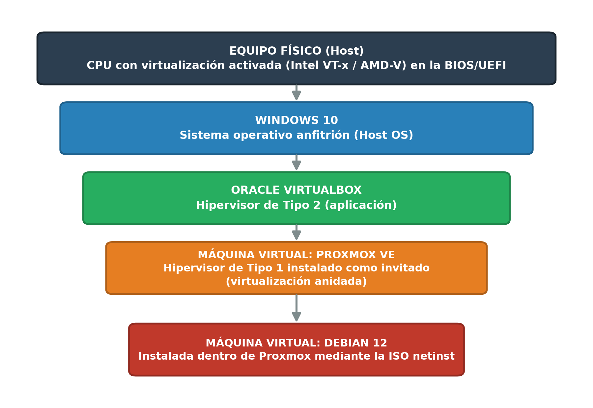
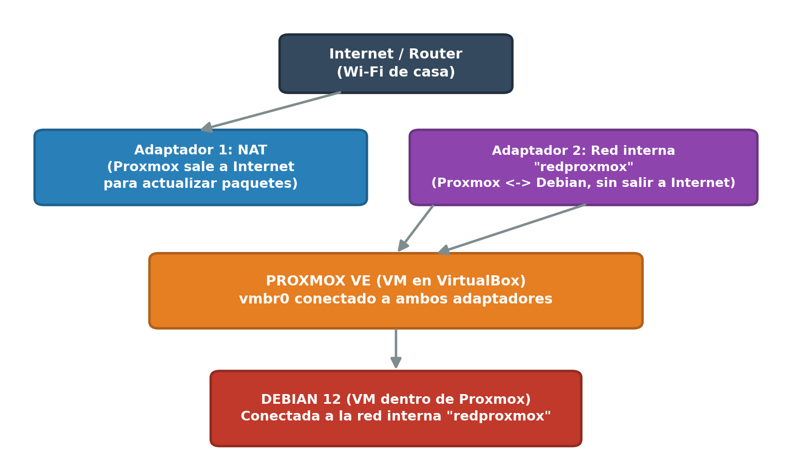
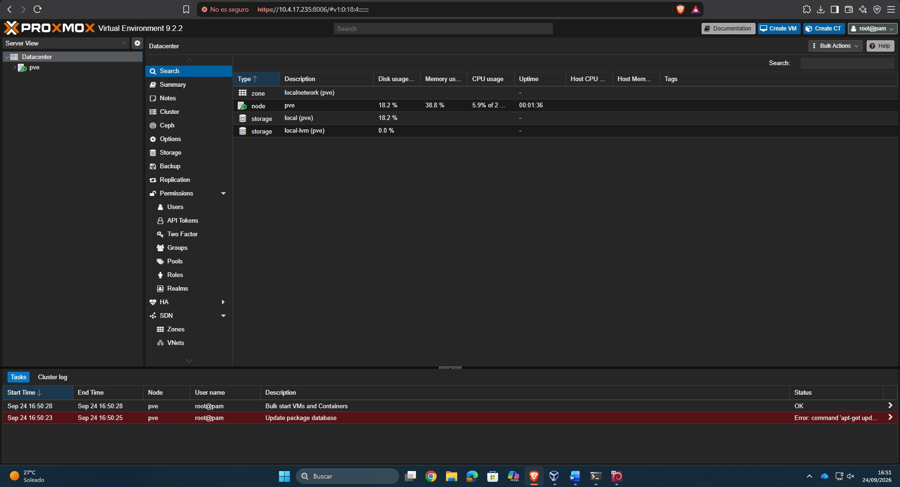
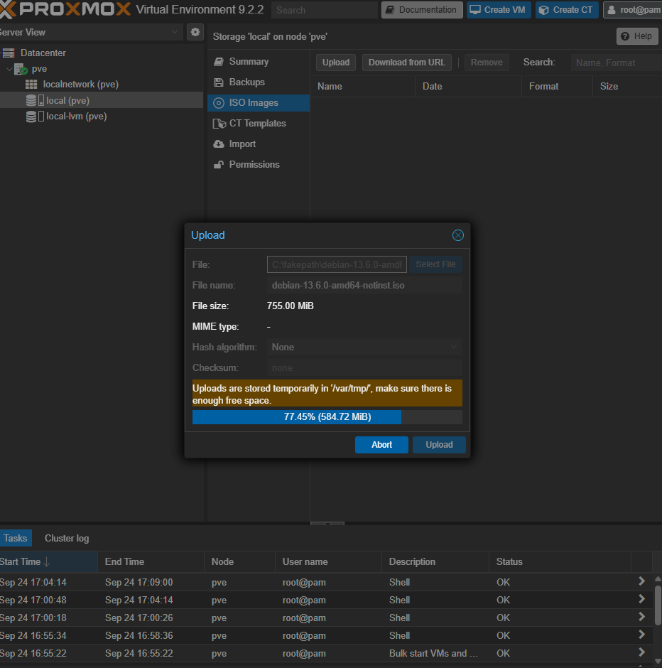
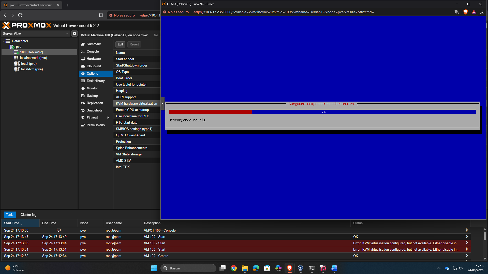
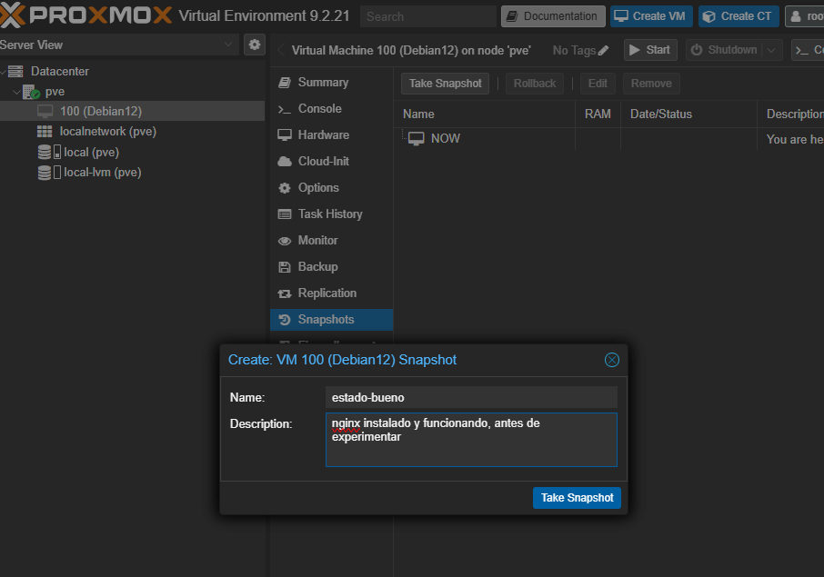

# Laboratorio de virtualización con Proxmox VE

Despliegue de **Proxmox VE 9** en virtualización anidada dentro de VirtualBox y administración del hipervisor desde su interfaz web: creación de máquinas virtuales, contenedores **LXC** e **instantáneas** (snapshots).

Prácticas de *Administración de Sistemas Operativos* (2º ASIR).

## Arquitectura



| Capa | Detalle |
|---|---|
| Anfitrión | Windows con VirtualBox 7 |
| Hipervisor | Proxmox VE 9.2 en una VM de VirtualBox con virtualización anidada |
| Red | Adaptador NAT (salida a Internet) + red interna `redproxmox` para las máquinas de Proxmox |
| Invitado | Debian netinst como VM 100 |



## Qué se ha hecho

### 1. Instalación de Proxmox VE en VirtualBox

Creación de la VM con virtualización anidada activada:

```powershell
cd "C:\Program Files\Oracle\VirtualBox"
VBoxManage.exe modifyvm "ProxmoxVE" --nested-hw-virt on
```

Instalación desde la ISO y acceso a la consola web en `https://IP_DE_PROXMOX:8006` con el usuario `root@pam`.

### 2. Máquina virtual Debian

Subida de la ISO netinst al almacenamiento `local`, creación de la VM 100 y arranque del instalador desde la consola noVNC.

### 3. Contenedores LXC

Descarga de una plantilla de sistema desde *local > CT Templates* y creación de un contenedor desde **Create CT**. A diferencia de una VM, el contenedor comparte el kernel de Proxmox, arranca en segundos y no necesita las extensiones de virtualización del procesador.

### 4. Instantáneas

Uso de *Snapshots* sobre la VM de Debian con Nginx instalado:

| Acción | Para qué |
|---|---|
| **Take Snapshot** (`estado-bueno`) | Guardar el estado antes de experimentar |
| **Rollback** | Volver a ese estado después de romper algo a propósito |
| Encadenar varias | Tener distintos puntos de restauración |
| **Remove** | Borrar instantáneas que ya no hacen falta |

## Problema encontrado y solución

| Problema | Causa | Solución |
|---|---|---|
| La VM no arrancaba: *KVM virtualisation configured, but not available* | Proxmox corre dentro de VirtualBox y el procesador virtual no expone la aceleración KVM | Desactivar *KVM hardware virtualization* en *Options* de la VM. Arranca en emulación, más lenta pero válida para el laboratorio |

## Evidencias

| | |
|---|---|
|  |  |
| Panel del datacenter con el nodo `pve` | Subida de la ISO de Debian |
|  |  |
| Instalador de Debian tras resolver el error de KVM | Creación de la instantánea `estado-bueno` |
